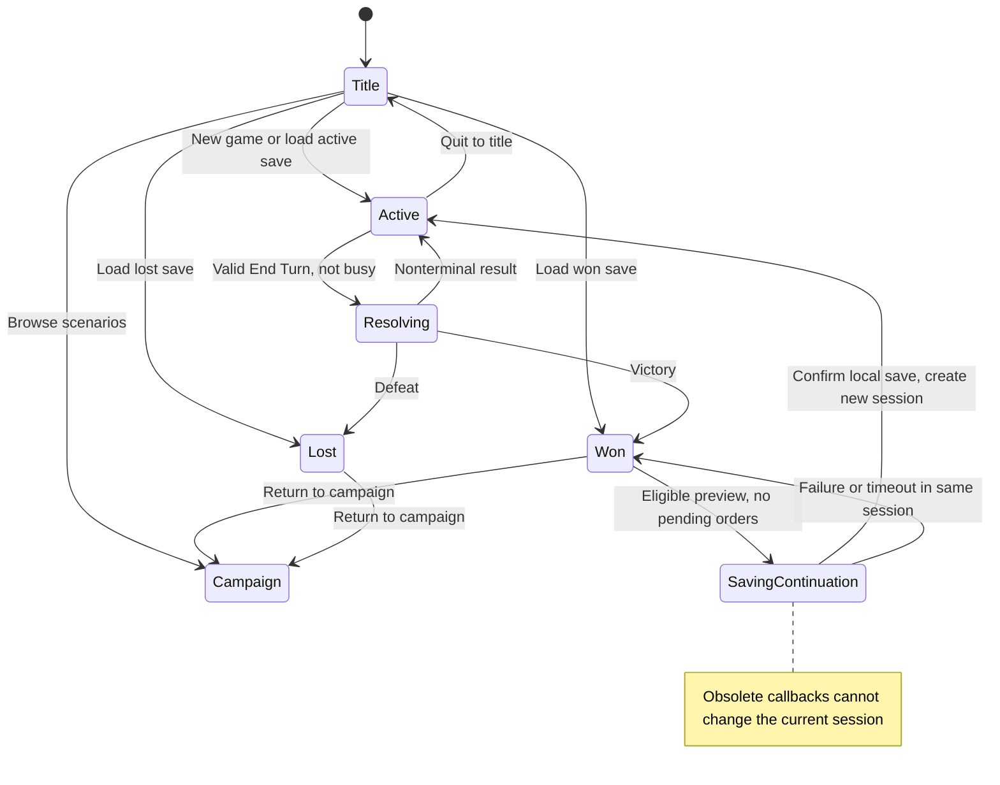

# Whole-game audit and feature cutoff — 14 November 2026

After Maria's 4 PM Manila cutoff, the team completed the expedition-continuation
task already underway and stopped starting gameplay features. Remaining ideas
are recorded in [the feature backlog](../../milestones/FEATURE_BACKLOG_2026-11-14.md).
The subsequent work is failure correction, validation, responsiveness and a
source/runtime privacy audit

PR [#9](https://github.com/mariyaholic/starfire_hearth_v2/pull/9) was kept frozen at
`90e3db5` and made ready. During validation, GitHub showed it had been merged;
the team verified that exact head is an ancestor of `origin/main` at `4ac2cd0`.
The continuation and audit belong to the separately reviewable
PR [#10](https://github.com/mariyaholic/starfire_hearth_v2/pull/10), now eligible to
target `main` without including #9's changes again. This session performed no
merge or deployment

## Read the evidence

| Report | What it establishes |
| --- | --- |
| [Plan and ownership](PLAN.md) | Cutoff, independent roles and acceptance boundaries |
| [Simulation audit](SIM_AUDIT.md) | Orders, turns, economy, fleets/tasks, research, events, objectives, saves, content and asset/telemetry tools |
| [App audit](APP_AUDIT.md) | Routing, callbacks, session ownership, persistence, rendering/audio lifetime, release probes and CI |
| [Independent review](REVIEW.md) | Source judgment, independently run checks and explicit gaps |
| [Actual playtest](PLAYTEST.md) | Native warning/delete controls, release Web save/reload, bounded network and storage capture |
| [Astra advisory](ADVISORY.md) | Baseline risk inventory, including issues outside the bounded fixes |
| [Continuation report](../../milestones/M2F_REPORT.md) | Completed feature and its separate native/Web reload evidence |
| [Consolidated validation](VALIDATION.md) | Frozen source, 418 passing tests, exports, browser checks and retained logs |
| [CI browser follow-up](CI_BROWSER_FOLLOWUP.md) | Retained remote capture failure, isolated test lifecycle and pinned before/after evidence |

The inventories name states, transitions, authoritative writers and failure
boundaries across the application. They are risk-based audits, not exhaustive
enumeration of all possible states or a formal security certificate

The central session boundary is shown below. Pending decisions, queues, overlays,
campaign progress and render jobs have their own machines in the detailed reports

Native continuation confirms the checked filesystem write; Web continuation
requires the exact IndexedDB record before activating the new session

## Failure boundaries repaired

- Snapshot submitted and exported orders so later object mutations cannot change
  execution after preview, and separate player commands from trusted AI orders
- Guard terminal, busy, reentrant and stale-session operations; prevent detached
  load/delete/navigation and old advisor/checklist callbacks from acting
- Reject checksummed saves whose pending events cannot be resolved, whose ship
  tasks have invalid targets, or whose stable growth counters are unnormalized
- Skip live IDs when stale saved allocation counters would otherwise overwrite
  an existing entity, queue entry or scheduled event/effect
- Reject fixed-point authoring overflow and negative resource amounts before
  conversion or cost application
- Keep destructive smoke/probe routes out of release exports and test release
  storage separately from debug instrumentation
- Report automatic-save failures, confirm destructive save deletion and wait for
  exact local IndexedDB bytes before announcing a Web manual save
- Write campaign progress through a checked temporary file and atomic rename;
  warn when saving fails while retaining the current in-memory unlocks
- Bound independent browser verification operations and clean each operation up
  after match, timeout or error
- Reject asset ZIP metadata traversal and oversized intake; make check mode
  genuinely write nothing
- Fail CI on any failed child and on missing explicitly required telemetry groups,
  seeds, scenario or replay evidence, rather than treating absent work as success

Each author report identifies its reproductions, focused regressions and any
remaining exception. In particular, the historical uncatalogued `test` scenario
retains its committed post-outcome golden behavior; normal playable scenarios
and the application facade have terminal guards. No golden was silently rebaselined

## Local data and privacy

The inspected runtime reads bundled content and user-local gameplay saves,
settings, campaign progress and workspace/presentation state. Saves may include
player-entered colony names; players could put personal text there, even though
the game does not ask for personal information. Save thumbnails capture the game
viewport. Window/monitor and browser capability values support display and input

Native storage uses Godot `user://`; Web uses origin-scoped IndexedDB and a scalar
view-mode preference in localStorage. The save verifier reads the existing local
save record and does not create a second persistent save database or upload it

Source inspection found no application account login, personal-identifier lookup,
microphone capture, HTTP/WebSocket client, analytics beacon, cloud TTS or upload
endpoint in the reviewed runtime. Local voice clips are distinct from Maria's
separate voice pipeline. Browser asset requests, deliberate external links,
developer automation and hosting/browser/OS behavior must not be confused with
application collection. Hosting logs, browser extensions and engine/dependency
internals are outside this source audit

## Responsiveness and remaining limits

Checkpoint autosaves now share one captured thumbnail with the auto slot. The
removed second GPU readback measured 17–33 ms in ten software-rendered samples
on this machine. This is the duration of that redundant operation, not a claim
about overall frame rate or physical GPU performance

Ordinary Web autosaves still rely on asynchronous virtual-filesystem syncing;
they do not have the exact-byte acknowledgment used by continuation and manual
save. A page close immediately afterward can race persistence. Browser storage
denial, quota exhaustion, eviction and late completion cannot be turned into a
universal durability guarantee

Load-list parsing, thumbnail decoding, manual-slot counts and retained event
history do not have comprehensive size/latency budgets. An arbitrary new save
size cap would reject otherwise supported opaque presentation payloads, so this
audit preserves save compatibility and records that boundary. No claim of safe
processing of every malicious or extremely large local file is made

Settings-file write errors are still not surfaced. The new campaign warning
confirms native filesystem failure handling, not exact Web campaign durability

Linux/Xvfb and Chromium use software rendering here. Exporting a Windows binary
does not establish Windows installation or execution. Native Windows/Wine,
physical phones, hardware GPU drivers, audible output and long-duration/multi-tab
storage behavior remain unverified in this environment

The frozen suite passed **418 tests / 15,038 checks**. Consolidated commands,
source digests and raw logs are in [VALIDATION.md](VALIDATION.md); independent
disposition is in [REVIEW.md](REVIEW.md). Earlier M2F or CI results do not certify
later audit changes

[The evidence manifest](EVIDENCE_MANIFEST.json) records every audit file's size
and SHA-256. Captured playtest files retain their original bytes and line endings;
the local attributes preserve those records without relaxing source checks
